# PST Forever

**Turn-based combat, real lighting, dice rolls and a bigger party for _Planescape: Torment: Enhanced Edition_.**

[](https://discord.gg/AgRUs6wwVM)
<p align="center">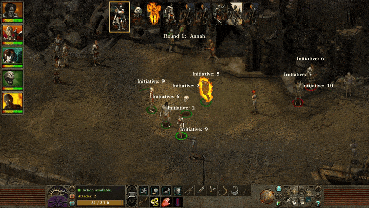</p>

Torment has one of the best stories in any cRPG but after playing a lot of modern games and Baldur's Gate 3 I found the game to be very... clunky. Which is why I made this: fights become turn-based, the Hive gets torch light and
night shadows, and the stat checks hidden in dialogue become dice you can roll.

NOTE: This is entirely vibe-coded with Opus 5.5.

This is a small native plugin that hooks into the original `Torment.exe` and
uses the engine's own rules for everything: the same THAC0, the same saves, the same scripts, the same
dialogue.

---

## What you get

### Turn-based combat

When a fight starts, the world pauses and everyone rolls initiative. Each character gets a turn with
one action and 31 ft of movement, BG3-style.

- **Initiative cards** across the top, a **hotbar** in the bottom bar and the party portraits on the left.
- **Movement preview**: hover anywhere and a line shows how far you can walk this turn (gold) and what is out of reach (red).
- **Maneuvers**: Run, Withdraw, Block, Trip and Knockdown, each with its own rules card.
- **Attacks of opportunity** when someone walks out of melee.
- The enemy AI gets the same turn rules: it runs to close in, blocks when it is hurt and surrounded, and sometimes tries to trip you.
- Spell durations, regeneration and poisons tick on the round clock, so a 3-round Blur lasts 3 of your turns.
- Press **End** to end a turn early. When the last enemy falls, the game goes back to real time.

There are probably some broken stuff as I have barely tested but please make an issue / repro and I can look into it.

<p align="center">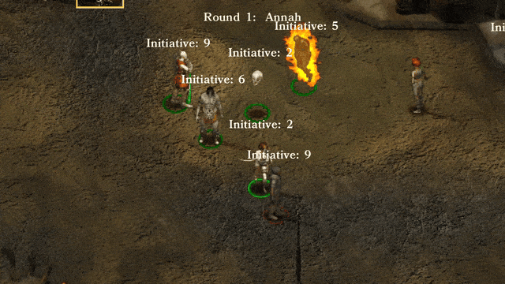</p>

<p align="center">
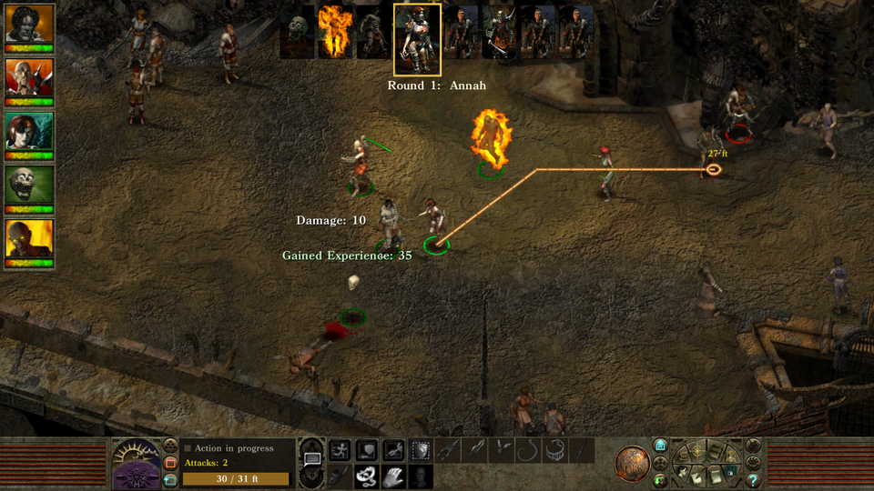
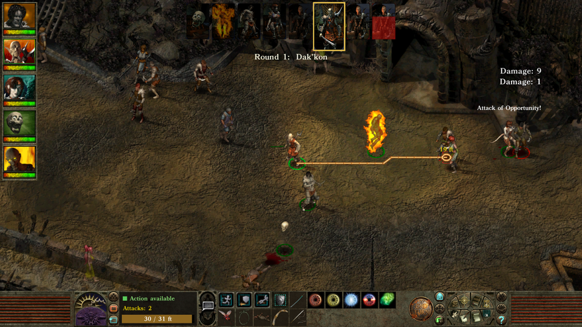
</p>
<p align="center">
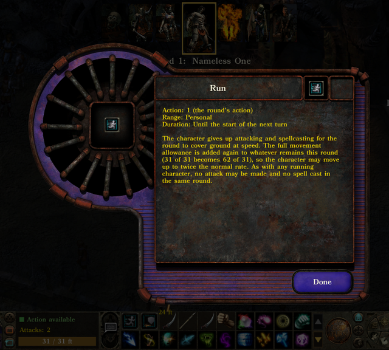
</p>

### Dialogue dice rolls

In vanilla, a reply that needs 13 Strength simply doesn't show up if you have 12. With PST Forever
those replies are listed, obscured, and clicking one opens a roll: **d20 + your ability modifier vs a
difficulty class**. Natural 20s and natural 1s count. Win, and the reply opens up for that conversation.
The die is a real 3D d20 that tumbles, lands and shows the total.

<p align="center">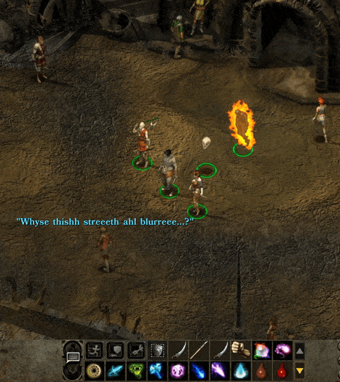</p>

### Lock picking and door bashing

Locked doors and chests get the same panel: pick with lockpicking skill, or bash with Strength. Fail and
that lock is jammed for an hour. The game's own lock actions still do the work, so traps, sounds and XP are
delegated to the original game.

<p align="center">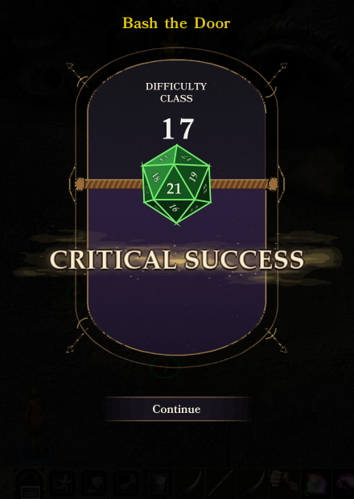</p>

### 8-member party

Travel with the Nameless One and all seven companions at once. The portrait column grows to eight, and
every member has their own character record, inventory, spell book and marker on the area map.
Joining, leaving, saves and scripts all go through the engine's own code. The game's party lists are
moved to 8-slot copies and every check that assumed six is patched.

<p align="center">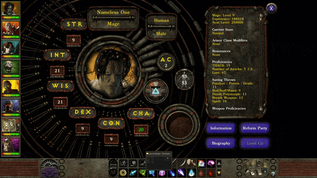</p>

### Dynamic lighting _(optional download)_

Fires, torches and glowing spells light the scene around them. Night is actually dark, with warm pools
of light around braziers; characters cast shadows and pick up the colour of the light they stand in.
Spell effects glow and bloom.

<p align="center">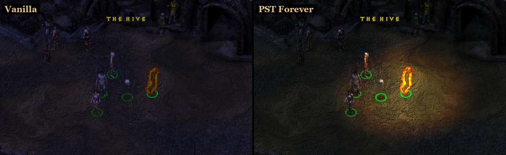</p>
<p align="center">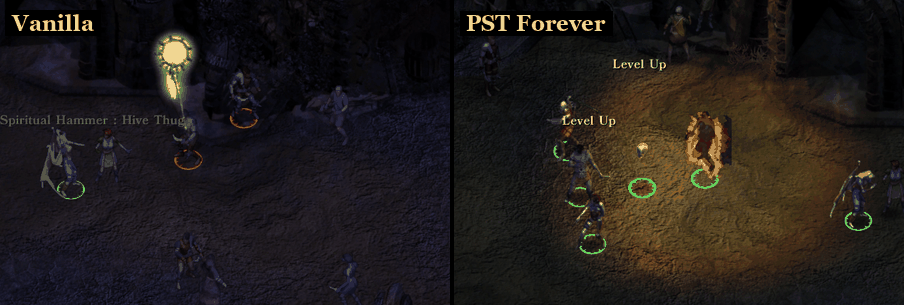</p>

Lighting needs per-area data (height, normals, baked lights), so it ships as a separate
`pst_forever-…-lighting.zip` (about 1.4 GB) and is **off by default**. I will need to upload this somewhere, stay tuned. Turn it on in the options window
after installing it.

### And more

- **Gore**: hits splash blood that matches what was hit (flesh, bone, metal), criticals spray, and stains stay on the floor for a while.
- **Smooth motion**: creatures and projectiles glide between the engine's steps instead of hopping. Game timing doesn't change.
- **Examine voice-over**: with PST Revoiced installed, the "examine" (?) text you click in the world is read aloud too, and a new line or a dialogue cuts the old one off.

---

## Installing

**You need:** _Planescape: Torment: Enhanced Edition_ **GOG version 3.2.2.0** (64-bit). Other versions,
including Steam builds with a different `Torment.exe`, are not supported yet: the plugin checks the game's
code before it touches anything, and switches a feature off rather than crash if the code doesn't match.
I don't offer support for anything other than this version, feel free to fork or make a PR.

1. Download `pst_forever-<version>.zip` from the [Releases page](https://github.com/b5635/pst-ee-forever/releases).
2. Unzip it into your game folder, next to `Torment.exe` (for example `C:\GOG Games\Planescape Torment - Enhanced Edition`).
3. Start the game as usual.

Works alongside WeiDU mods (tested with PST-UB-Reloaded).

**To uninstall:** delete `version.dll`, `pst_forever.dll`, `pst_forever_config.exe` and the `pst_forever`
folder from the game folder.

Please backup your saves before trying this, in case something screws up or future saves become messed up. This is especially the case if you have 8 party members enabled.

## Options

Run **`pst_forever_config.exe`** in the game folder. Every feature has its own switch and every setting
explains itself in the box underneath. Changes apply the next time you start the game.

<p align="center">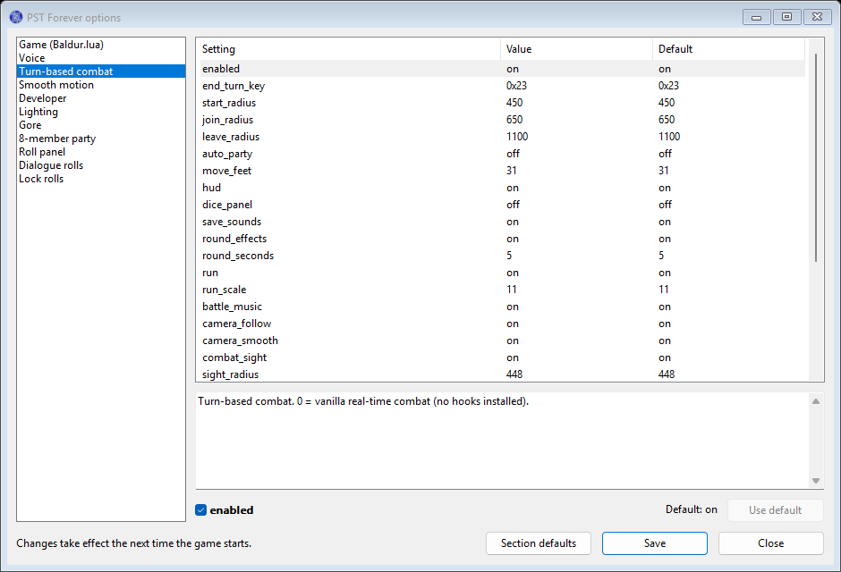</p>

Everything lives in `pst_forever\pst_forever.ini` if you prefer a text editor. Setting a module to `0`
removes its hooks completely.

## Something went wrong?

- The log is at `<game>\pst_forever\logs\pst_forever.log`, and fights write a round-by-round
  `combat.log` next to it. Please attach both to bug reports.
- If the game crashes, the engine writes a dump to `Documents\Infinity Engine - Enhanced Edition\crash\`;
  attaching the newest one helps a lot.
- To rule the mod out, switch the suspect feature off in the options window (or all of them).

[Open an issue](https://github.com/b5635/pst-ee-forever/issues) with what you did, what you expected and what happened,
or ask on [Discord](https://discord.gg/AgRUs6wwVM).

---

## For developers

PST Forever is a C++ DLL loaded through a small `version.dll` proxy. Every hook is checked byte-for-byte
against the on-disk `Torment.exe` before it is installed. Game logic lives in pure functions with unit tests;
features are also tested in the running game by Lua scripts that load a save, play out a scenario and assert
on the result.

```powershell
tools\check.ps1
```

builds the project (MSVC 2019 v142, CMake, x64), runs the unit tests and verifies every hook. `tools\deploy.ps1`
copies the build into the game folder and `tools\launch.ps1` starts the game straight into a save.
See [`docs/ARCHITECTURE.md`](docs/ARCHITECTURE.md) for how it fits together and [`CLAUDE.md`](CLAUDE.md) for the
full list of tools, in-game tests and probes.

The pictures in this README come from those in-game tests: `tools\record.ps1` records a scenario
(ffmpeg Desktop Duplication), `python -I tools/readme_gifs.py` cuts the GIFs (ffmpeg + gifski) and
`python -I tools/readme_media.py` makes the stills.

If you still have trouble, feel free to contact me or point your favorite LLM at it.

## Credits and license

- The [GemRB](https://gemrb.org) project, whose code and lighting data several features are ported from.
- The [IESDP](https://gibberlings3.github.io/iesdp/) for decades of file-format documentation.
- Beamdog and Black Isle for the game.

PST:EE Forever is free software under the **GNU GPL v2 or later** ([COPYING](COPYING)). It contains no game
files; you need your own copy of _Planescape: Torment: Enhanced Edition_.
